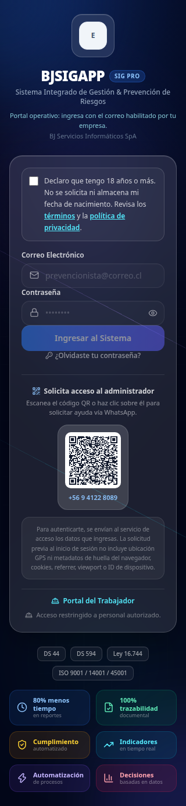
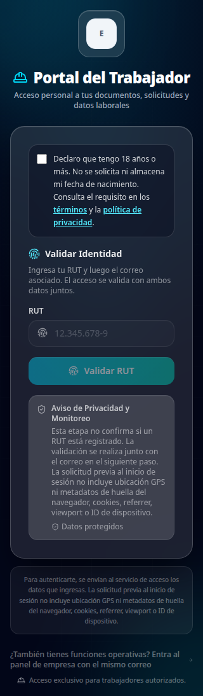

# Auditoría de portales BJSIG

**Fecha:** 10 de noviembre de 2026
**Alcance:** portal de empresa/administración, portal del trabajador, acceso, shell compartido y modal de alta/edición de trabajadores.
**Resultado:** **13/20 — aceptable con reservas.** Se encontraron desajustes concretos de accesibilidad, tema y alineación, además de desplazamiento horizontal interno de la tabla de trabajadores en tablet. **No se modificó código de la aplicación; solo se publica este informe y sus capturas.**

## Qué se comprobó

- Inspección de `Layout`, `WorkerLayout`, `Auth`, `WorkerAuth`, `WorkerPortal`, sus pestañas, `WorkerTable`, `WorkerModal`, el modal común, componentes de UI y estilos globales.
- Render en Chromium de las pantallas **sin sesión** `/admin` y `/trabajador` en anchuras de **320, 360, 390, 768 y 1280 px** (900 px de alto). No hubo errores JavaScript. El ancho desplazable del documento coincidió con el viewport en las diez combinaciones; las capturas de 320 px muestran los campos y botones dentro de la pantalla.
- Una comprobación de escritorio del acceso administrativo a 1280 × 1100 px confirmó scroll vertical normal y ningún desbordamiento horizontal del documento.
- La raíz de las pantallas de acceso tiene `scrollWidth` interno mayor por los círculos decorativos con blur posicionados fuera del contenedor. La raíz los recorta y las capturas confirman que no desplazan ni recortan los campos. Por tanto, **no se cuenta como overflow funcional observado**.
- El detector Impeccable estático completó un único análisis de código: **10 avisos heurísticos de estilo y 1 advisory** (bordes de acento, gradientes violetas/índigo, fuente Inter y easing con rebote). No detectó por sí mismo una regla de overflow. Esos avisos no se interpretan como defectos funcionales probados.

## Puntuación Impeccable

| Dimensión | Nota | Evidencia / límite |
|---|---:|---|
| Accesibilidad | 2/4 | Etiquetas sin asociación programática, controles solo-icono y diálogo común sin ciclo de foco completo. |
| Rendimiento | 3/4 | Las vistas usan carga diferida; no se hizo perfilado CPU/GPU y no se confirma regresión de rendimiento. |
| Theming | 2/4 | Hay tokens claros/oscuros, pero siguen apareciendo textos fijos de la paleta clara en tarjetas y formularios. |
| Responsive | 3/4 | Los accesos renderizados caben en móviles; una grilla queda desbalanceada y la tabla obliga a scroll interno en tablet. |
| Integridad de implementación | 3/4 | Los flujos principales están implementados y separados; no se renderizaron vistas autenticadas en la sesión de esta auditoría. |
| **Total** | **13/20** | **Aceptable con reservas.** La puntuación de áreas autenticadas se basa principalmente en código. |

## Hallazgos priorizados

### P1 — Etiquetas de campos de autenticación sin asociación accesible

En el acceso de empresa (`src/views/Auth.tsx`) y el acceso del trabajador (`src/views/worker-auth/ui.tsx`, `RutForm.tsx` y `LoginForm.tsx`), el texto visible de las etiquetas no está conectado a los inputs mediante `htmlFor`/`id` ni contiene el control. Los placeholders no sustituyen el nombre persistente del campo. Esto puede hacer que el lector de pantalla no anuncie “RUT”, “Correo Electrónico” o “Contraseña”. Asociar un `id` estable con cada `label` y comprobar también el MFA y recuperación. **WCAG 1.3.1 y 3.3.2.**

### P1 — El modal compartido no asegura el foco de un diálogo

`src/components/ui.tsx:114-140` marca el contenedor como diálogo modal, pero el código propio no establece foco inicial, confinamiento de Tab, retorno del foco ni cierre por Escape. Lo usa el formulario extenso de alta/edición de trabajadores. A simple vista el contenido se desplaza dentro del modal, pero eso no resuelve teclado y tecnologías de asistencia. Preferir el diálogo accesible Radix ya disponible o implementar esas conductas conservando el scroll interno. **WCAG 2.1.1 y 2.4.3.**

### P2 — Seis métricas en una grilla de cinco columnas

`src/views/WorkerPortal.tsx:204-240` declara cinco columnas en escritorio y renderiza seis tarjetas; la sexta cae sola a una segunda fila. Es el desbalance de alineación más claro encontrado en el portal. Ajustar la grilla a 3 × 2, seis columnas donde el ancho lo permita o una distribución explícita equivalente.

### P2 — Tabla de trabajadores con ancho mínimo de 900 px desde `sm`

`src/views/workers/WorkerTable.tsx:348-350` muestra la tabla desde 640 px y le fija `min-w-[900px]`, dentro de un `overflow-x-auto`. Entre **640–899 px** las columnas requieren desplazamiento lateral para consultar la lista. El scroll está contenido en la tabla y **no se observó que expanda el documento**. Mantener las tarjetas hasta un ancho suficiente o priorizar columnas y mover detalles a una vista secundaria.

### P2 — Contraste de tarjetas de estadísticas en modo oscuro por verificar

`src/views/workerportal/components.tsx:19-29` fija texto `text-slate-800` en una tarjeta cuyo fondo usa el token de superficie adaptable; los tokens oscuros están definidos en `src/styles.css`. En tema oscuro esto puede producir texto oscuro sobre superficie oscura. Es un riesgo de código: **no se midió ratio de contraste renderizado**. Reemplazar colores fijos por tokens de primer plano y verificar estados claro/oscuro.

### P2 — Controles y pestañas del trabajador no exponen su estado/nombre

En el portal del trabajador, la selección de pestañas y categorías se comunica principalmente por clases visuales y no por `aria-selected`/`aria-pressed` o semántica de tabs/radio. Los botones para mostrar contraseña y para editar trabajador son solo icono, sin nombre accesible contextual; los errores dinámicos tampoco anuncian siempre su cambio. Añadir estado y nombres accesibles. Revisar `WorkerPortal.tsx`, `workerportal/DenunciasTab.tsx`, `worker-auth/LoginForm.tsx`, `FirstPasswordForm.tsx` y `workers/WorkerTable.tsx`.

### P3 — Movimiento reducido incompleto en pantallas autenticadas

Las animaciones y transiciones de vistas/controles no quedan todas cubiertas por `prefers-reduced-motion`; las reglas existentes favorecen landing/login. Incorporar una alternativa global para movimiento no esencial en los portales autenticados.

## Riesgos no contados como defectos observados

- `src/styles.css:201-205` usa `overflow-x: hidden` global, y varios shells también recortan overflow. En esta revisión no causó recorte funcional en las pantallas de acceso probadas; aun así puede ocultar un desbordamiento futuro si un módulo introduce contenido ancho. Mantener scroll horizontal acotado al componente que lo necesita y verificar qué hijo excede antes de ocultarlo en el shell.
- El formulario de alta de trabajador es largo y tiene scroll interno, que parece intencional. Una captura previa a 893 × 768 px muestra el inicio del formulario y su scroll; no se comprobó su interacción en móvil durante esta pasada.
- No se renderizaron con sesión el dashboard empresa/SaaS, la lista completa de trabajadores ni las pestañas autenticadas del trabajador. Sus recomendaciones correspondientes son de inspección de código, no mediciones visuales.
- No se hizo perfilado de rendimiento, medición automatizada de contraste ni prueba de zoom al 200 %.

## Fortalezas que conviene preservar

- Las pantallas de acceso de empresa y trabajador renderizadas a 320 px mantienen sus controles dentro del viewport y no producen desplazamiento horizontal del documento.
- La tabla confina su desplazamiento horizontal al componente, en vez de ensanchar intencionalmente toda la página.
- El modal limita su altura al viewport y conserva scroll interno, útil para formularios extensos.
- Varias vistas se cargan de forma diferida y la tabla de trabajadores pagina los registros.
- El shell contiene navegación móvil dedicada y objetivos táctiles de tamaño razonable.

## Secuencia sugerida de corrección

1. **P1 · `/impeccable harden`:** enlazar etiquetas/inputs y hacer accesibles el modal, pestañas, controles icon-only y mensajes de estado.
2. **P2 · `/impeccable adapt`:** equilibrar las seis métricas y reducir fricción de la tabla entre 640–899 px.
3. **P2 · `/impeccable colorize`:** reemplazar colores fijos de texto por tokens y medir contraste en ambos temas.
4. **P3 · `/impeccable animate`:** respetar movimiento reducido en vistas autenticadas.
5. Volver a auditar con una sesión QA segura en los tres contextos autenticados y a 320/390/768/1280 px; solo después decidir cambios de estilo globales.

## Estado del repositorio

No se modificó ningún archivo fuente de la aplicación. Los únicos archivos que se añaden al repositorio son este informe y las dos capturas de evidencia. `main` estaba limpia y sincronizada con `origin/main` antes de preparar el commit.
